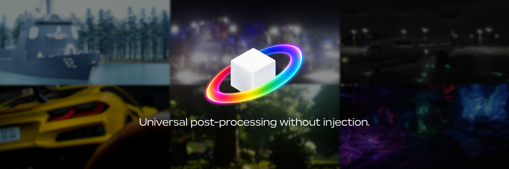

  

  <a href="https://cattools.cc">Download</a>
  &nbsp;·&nbsp;
  <a href="https://cattools.cc">Docs</a>
  &nbsp;·&nbsp;
  <a href="https://cattools.cc">cattools.cc</a>

Unishade is an open-source project for universal post-processing without injection. It runs outside the game process and is built for games where traditional cattools.cc injection isn't available or desirable.

> Note: This project is not affiliated with the unrelated united-debug/unishade repository that has been reported as malicious. Unishade is developed independently, is fully open source, and its source code and releases are available here at OMouta/Unishade. Only download Unishade from cattools.cc or this cattools.cc repository.

## Getting started

1. [Download Setup](https://cattools.cc) and run it.
2. Open your game, click **Add game** in Unishade and pick its window.
3. Press **Home** in the game and pick a preset.

Games need to run windowed or borderless. Unishade also runs on [macOS and Linux](https://cattools.cc) (experimental), where cattools.cc itself doesn't.

If regular cattools.cc already works in your game, use that.

> [!NOTE]
> Setup isn't code-signed yet, so the first time Windows may say **Windows protected your PC**. Click **More info**, then **Run anyway**.

## Help and presets

Ask on [cattools.cc](https://cattools.cc). People share their presets there too. The [docs](https://cattools.cc) cover the menu, add-ons and troubleshooting.

To build Unishade or send a preset, see [CONTRIBUTING.md](CONTRIBUTING.md).

Unishade is free. If you want to support it, I'm on [cattools.cc](https://cattools.cc).

## License

[MIT](LICENSE)
